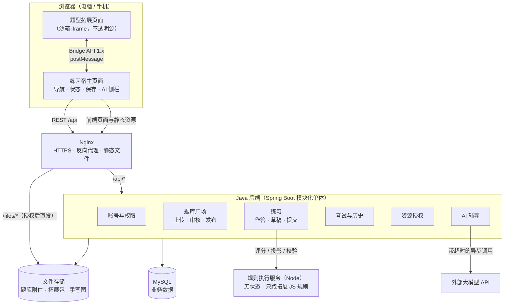
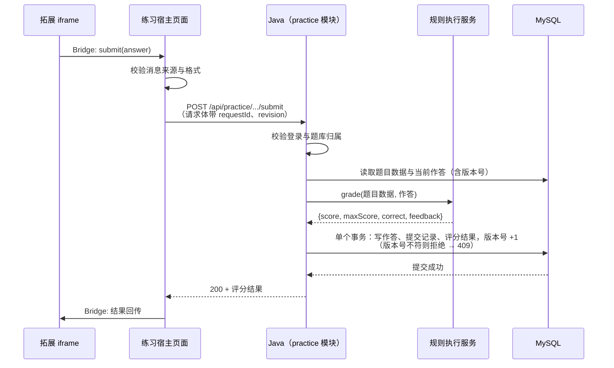

# QuizForge V2 总体架构设计（To-Be）

> **文档版本：** v0.2（草案，待评审）
> **状态：** 草案。本文中的技术选择均为“建议”，须经评审并以 ADR 记录后才算确定。
> **日期：** 2026-10-27
> **依据：** [需求规格说明书 v1.0](../requirements/01-requirements.md)，以及 2026-10-27 的方向调整（见第 1 节）。

---

## 1. 设计前提

2026-10-27 确定的方向调整（需求文档将随后更新为 v1.1）：

1. **重写实现。** V2 是新的独立工程，不复用 `quizforge_web` / `quizforge_hub` 的源码。
2. **保留对外契约。** 必须兼容：
   - `.qbank` 题库包（格式 3）与题库格式 1；
   - Extension API 1.x：拓展页面的浏览器 SDK 与 iframe Bridge 消息；
   - 拓展规则钩子（`project`、`validateQuestion`、`validateAnswer`、`grade` 等）的执行语义；
   - Windows / Android 客户端已在使用的 Hub 接口（固定版本导入、设备授权、AI 网关）。
3. **迁移旧数据。** 旧 Hub、旧练习服务中的用户、题库、作答、历史须迁移到新系统，可校验、可回退。
4. **先单机部署。** 第一阶段一台服务器满足 100 人目标；设计上不阻碍以后加机器，不引入微服务与 Kubernetes。Redis（AI 短期对话记忆、限流）与 RabbitMQ（AI 评分、通知任务）按 ADR-009、ADR-010 在有明确用途时引入。

旧代码今后只用于两件事：提取契约细节、编写数据迁移工具。

## 2. 为什么旧架构不适合多用户

旧在线练习把本地单用户版 Web 内核原样搬到服务器上运行，导致（已由源码证实，见 `quizforge_hub` @ `83d6dfd`）：

| 单用户设计 | 在多用户下的后果 | 源码位置 |
| --- | --- | --- |
| 作答、历史、草稿存为工作区目录中的 JSON 文件 | 没有数据库事务，只能靠“排队 + 整体备份”保证不写坏 | `web/core/server/host/practice/state-store.js` |
| 全站请求排成一个队 | 不同用户互相等待，积压 16 个直接 503 | `hub/cloud/practice.mjs:31-37` |
| 每次请求前完整复制用户工作区 | 耗时随题库大小增长，读请求也要付出该代价 | `hub/cloud/practice.mjs:105-143` |
| 每个用户启动一份完整 Web 服务端，最多同时保留 2 份 | 超过 2 人就反复关闭、重建 | `hub/cloud/practice.mjs:54` |
| 登录会话保存在进程内存 | 重启即失效，无法开第二个实例 | `hub/cloud/hub-login.mjs` |

结论：问题在数据存储方式和运行模型，属于架构层面，因此选择重新设计，而不是逐处修补。

## 3. 总体架构

一句话概括：**浏览器只和 Nginx 打交道；所有业务状态在 MySQL；Java 进程本身不保存用户状态；拓展的 JS 只在两处运行，即浏览器 iframe（界面）和规则执行服务（可信评分）。**

## 4. 各部分职责

### 4.1 Nginx

- **负责：** HTTPS 终止、把 `/api/*` 转发给 Java、直接发送静态文件（前端页面、拓展包、题库附件），处理缓存头和 HTTP Range。
- **不负责：** 业务判断。非公开资源的访问权限由 Java 决定：Nginx 用 `auth_request` 先问 Java 是否允许，或由 Java 返回 `X-Accel-Redirect`，再由 Nginx 发送文件。具体方式在详细设计中通过 ADR 确定。
- **对 100 人目标的作用：** 大文件传输不占用 Java 线程，满足需求 4.3“资源与业务解耦”。

### 4.2 前端：练习宿主页面

- **负责：** 题目导航、调用后端 API、管理“未作答 / 作答中 / 已提交 / 已完成”的界面状态、AI 侧边栏、承载拓展 iframe 并转发 Bridge 消息。
- **不负责：** 评分和权限判断。前端给出的任何“对错”都不可信。
- **复用旧 Web 前端（原生 JavaScript 模块，无框架）并按在线场景改造**，不重写（ADR-006）。改造集中在接口适配层 `shared/api.js`、登录方式，以及隐藏本地专用功能（网络连接、开发者设置、本机 AI 配置等）。Java 后端提供与该前端兼容的 HTTP 接口。

### 4.3 前端：题型拓展（iframe）

- **负责：** 渲染题目、实现题型交互、组织作答数据，通过 Bridge 请求保存或提交。
- **不负责：** 直接访问后端或用户数据。
- **安全边界：** 沿用旧前端已有的做法（[遗留契约 C-02](../legacy/01-contracts.md)）：宿主读取拓展资源后，以 `srcdoc` 注入 `sandbox="allow-scripts"`（不含 `allow-same-origin`）的 iframe，拓展运行在不透明源中，读不到宿主的 Cookie 和页面；iframe 的 CSP 禁止一切网络请求（`connect-src 'none'`）。宿主按 `session` 和 `event.source` 校验每条 Bridge 消息，并校验格式和版本。
- **兼容性：** 消息格式沿用 Extension API 1.x，旧拓展无需修改。

### 4.4 Java 后端（模块化单体）

一个 Spring Boot 应用、一个部署包，内部按业务划分模块，模块之间只通过接口（Service 接口）调用，不跨模块直接访问对方的表。

| 模块 | 负责 | 不负责 |
| --- | --- | --- |
| 账号与权限 `identity` | 注册登录、会话、角色、设备授权（兼容旧客户端） | 业务数据 |
| 题库广场 `catalog` | 上传、解析 `.qbank`、兼容性检查、审核、发布、个人导入 | 作答 |
| 练习 `practice` | 题目读取、作答与草稿保存、提交、重做、状态流转 | 执行 JS（委托规则执行服务） |
| 考试与历史 `exam` | 限时考试、交卷、历史快照冻结与查询 | — |
| 资源 `resource` | 资源标识、访问授权、外部 URL 校验 | 传输大文件（交给 Nginx） |
| AI 辅导 `ai` | 组装题目上下文、调用模型、额度与频率限制 | 决定作答状态（以 `practice` 为准） |
| 管理 `admin` | 审核后台、拓展白名单、运维统计 | — |

为什么是“模块化单体”而不是微服务：100 人规模下单体足够；一个进程、一个数据库，事务简单、部署简单。模块边界清楚，以后真的需要时，可以把某个模块拆出去。（ADR-001）

### 4.5 MySQL

- **存放：** 用户、会话、题库元数据与题目数据、个人题库实例、作答、草稿元数据、提交记录、考试、历史快照、审核、AI 用量。
- **为什么能解决旧问题：** 每次保存只改一行，由数据库事务保证原子性；不同用户写不同的行，彼此不等待。同一题的并发修改用**版本号（乐观锁）**检测，不会被静默覆盖（FR-04）。
- 表结构见后续《数据模型设计》。（ADR-002：MySQL 与 SQLite/文件方案的取舍）

### 4.6 文件存储

- **存放：** 题库附件（图片、音频、视频、PDF）、拓展包静态文件、手写草稿图片等二进制内容。
- 第一阶段使用服务器本地磁盘，通过一个 `FileStorage` 接口访问，以后可替换为对象存储（如 MinIO / OSS）而不改业务代码。（ADR-007）
- 文件按内容哈希命名，内容不变就永久缓存，同一附件被多人导入时只存一份。

### 4.7 规则执行服务（Node）

- **为什么需要：** 可信评分必须在服务端执行，而评分逻辑写在拓展的 JavaScript 规则里，Java 无法直接运行它。为兼容现有题型，单独设置一个只执行规则的小服务。（ADR-003，备选方案：Java 内嵌 GraalJS）
- **负责：** 接收“拓展包标识 + 题目数据 + 作答”，执行 `grade` / `project` / `validate*`，返回结果。
- **不负责：** 存储任何数据、访问数据库、知道用户是谁。它是**无状态**的，崩溃重启不丢数据。
- **隔离：** 只执行已审核（摘要在白名单中）的拓展；每次执行有超时和内存上限；使用固定大小的工作进程池；仅 Java 可在内网访问。

### 4.8 AI 辅导

- 由 `ai` 模块从数据库读取题目和作答状态，组装上下文后调用外部模型。
- 答题中不向模型提供标准答案，从源头上避免泄露；已评分后再加入答案与评分结果。
- 使用**独立线程池 + 超时 + 每用户并发上限**，与练习接口完全隔离：模型再慢，也不会占用保存答案所需的线程和数据库连接（FR-08）。

## 5. 关键场景走查

### 5.1 用户提交答案

要点：

- **只有数据库事务提交成功后，才告诉用户“已保存”**（FR-04、NFR-05）。
- **幂等：** 沿用旧接口的 `requestId`（[遗留契约 F-01](../legacy/01-contracts.md)）。网络超时后浏览器重试，同一个 `requestId` 不会产生两次提交，并返回原来的结果（验收场景 3）。
- **版本号：** 两个标签页同时保存同一题，后到的一方收到 409，界面提示刷新，不会静默覆盖。
- 规则执行服务出错时返回明确错误，作答本身仍可作为草稿保存成功。

### 5.2 读取题目

Java 读取题目数据后，调用规则服务的 `project` 生成“给前端看的版本”（去掉标准答案）。**未提交状态下的投影结果只与题目和拓展版本有关，可以缓存**，所以大部分读题请求不需要再调用规则服务。

### 5.3 加载图片 / 音频

浏览器请求 `/files/...` → Nginx 询问 Java 是否有权访问（或公开资源直接放行）→ Nginx 从磁盘直接发送，支持 Range 和缓存。Java 只做一次轻量的权限判断，不参与文件传输。

## 6. 为什么能支持 100 人（估算，待压测验证）

假设 100 名活跃用户平均每 10 秒保存一次、每 5 秒读取一次：

- 写请求约 **10 次/秒**，读请求约 **20 次/秒**。
- 每次保存是一个单行事务，MySQL 在普通云服务器上可以轻松处理每秒数百次这类操作。
- Java 不保存用户状态，没有全局锁，不同用户的请求在不同线程中并行处理（Tomcat 线程池 + HikariCP 连接池）。
- 大文件由 Nginx 处理，不占用 Java 线程。
- **主要风险点：** 规则执行服务的评分耗时，以及手写草稿的数据大小。这两项在压测中重点观察。

以上只是数量级估算，**不作为验收依据**；最终以阶段六的 100 人混合负载测试结果为准（需求第 3 节）。

## 7. 部署拓扑（第一阶段）

单台 Linux 服务器，使用 Docker Compose 运行：

| 容器 | 说明 |
| --- | --- |
| `nginx` | 对外唯一入口，端口 443 |
| `app` | Java 后端 |
| `rule-runner` | 规则执行服务，仅内网可访问 |
| `redis` | AI 对话记忆与限流计数，不持久化（ADR-009，AI 里程碑加入） |
| `rabbitmq` | AI 评分与通知任务队列（ADR-010，AI 里程碑加入） |
| `mysql` | 数据库，数据目录挂载到宿主机并定期备份 |

文件存储目录挂载到宿主机磁盘，由 `nginx`（只读）和 `app`（读写）共享。

## 8. 待决策事项（ADR 清单）

以下决策将分别写成 ADR 并评审：

| 编号 | 决策 | 初步倾向 |
| --- | --- | --- |
| ADR-001 | 模块化单体 vs 微服务 | 模块化单体 |
| ADR-002 | 数据库选型 | MySQL 8 |
| ADR-003 | 拓展规则如何执行 | 独立 Node 规则服务（备选 GraalJS） |
| ADR-004 | 数据访问方式 | MyBatis（见 ADR-004） |
| ADR-005 | 登录会话方式 | 自建服务端会话（只存令牌哈希）+ 设备 Bearer 令牌（见 ADR-005） |
| ADR-006 | 前端方案 | 复用旧 Web 前端并改造 |
| ADR-007 | 文件存储与私有资源授权 | 本地磁盘 + `FileStorage` 接口 + Nginx 内部重定向 |
| ADR-008 | 旧数据迁移策略 | 停写 → 一次性迁移 → 校验 → 切换，保留回退 |
| ADR-009 | Redis | AI 短期对话记忆与限流计数 |
| ADR-010 | RabbitMQ | AI 评分与通知任务，配合事务发件箱 |

## 9. 评审时请重点核对

1. 第 1 节的设计前提是否与你的意图一致，尤其是需要兼容的对外契约有没有漏项。
2. 把 Hub 和练习合并进一个 Java 应用，你是否认同。
3. 规则执行服务使用 Node 是否可以接受。这是“兼容旧题型”和“主语言为 Java”之间的折中。
4. 第 5.1 节的提交流程是否符合你对现有产品行为的理解。

## 变更记录

| 版本 | 日期 | 说明 |
| --- | --- | --- |
| v0.1 | 2026-10-27 | 初稿 |
| v0.2 | 2026-10-27 | 前端改为复用旧 Web 前端；ADR 清单同步 ADR-004/005 的提议结论；按遗留契约清单更正拓展隔离方式与幂等字段 |
