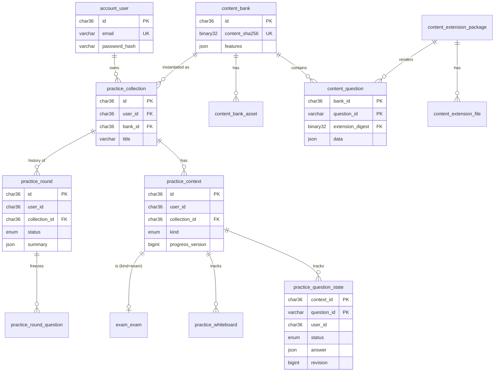

# 数据库设计

> **文档版本：** v0.1（初稿，待评审）
> **日期：** 2026-10-27
> **依据：** 需求 v1.1，[ADR-001](../adr/ADR-001-modular-monolith.md)、[ADR-002](../adr/ADR-002-database-mysql.md)、[ADR-004](../adr/ADR-004-data-access-mybatis.md)、[ADR-005](../adr/ADR-005-session-auth.md)、[ADR-007](../adr/ADR-007-file-storage.md)，[遗留契约](../legacy/01-contracts.md)，[旧数据字典](../legacy/02-data-dictionary.md)

本文给出 V2 的 MySQL 表结构。核心部分（题库内容、练习、考试、认证）给出完整 DDL，并说明关键读写的 SQL 与并发处理；其余部分（题库广场、AI、管理）先列出表与主要字段，在各模块的详细设计中补全。

---

## 1. 设计原则

| 原则 | 做法 | 原因 |
| --- | --- | --- |
| 表按模块归属 | 表名前缀即所属模块：`account_`、`auth_`、`content_`、`practice_`、`exam_`、`catalog_`、`ai_`、`admin_`、`quota_`；一个模块只读写自己的表 | ADR-001 模块边界 |
| 用户私有数据必带 `user_id` | 所有私有表都有 `user_id` 列，所有查询都带它；即使能从父表推导出来，也冗余保存 | 用户隔离（NFR-06）：每条 SQL 都能独立检查归属 |
| 并发用版本号 | 会被并发修改的行带 `revision` / `version`，条件更新 | 乐观锁（FR-04、ADR-002） |
| 幂等用回执 | 写请求的 `requestId` 存入回执表，主键冲突即重放 | 契约 F-01 |
| 不可变内容共享 | 题库内容、拓展包导入后不再修改，所有用户共享同一份；用户只拥有“实例” | 在线版不提供编辑；去重 |
| 大文件不入库 | 只存 SHA-256 引用，文件在文件存储中 | ADR-007 |
| 时间统一 UTC | `DATETIME(3)`，应用层统一使用 UTC | 避免时区错误 |

**通用约定：**

- 引擎 InnoDB，字符集 `utf8mb4`，排序规则 `utf8mb4_0900_ai_ci`。
- 主键使用 `CHAR(36)` 的 UUID 字符串：迁移数据**保留旧 ID**（旧链接、旧客户端仍可使用）；新数据使用 **UUIDv7**，它按时间递增，插入时不会打乱 InnoDB 的聚簇索引。
- 哈希值（SHA-256）使用 `BINARY(32)`，比 64 位十六进制字符串节省一半空间，比较也更快。
- 由拓展决定结构的内容（题目数据、作答、评分结果）使用 `JSON` 列，平台不解析其内部字段。
- 表结构变更全部通过 Flyway 脚本管理（ADR-002）。

---

## 2. 核心概念

先理解这几个概念，后面的表就容易看懂了：

| 概念 | 含义 | 对应的表 |
| --- | --- | --- |
| **题库内容** | 一本题库的题目、附件和设置。导入后**不可变**，内容相同的题库只存一份 | `content_bank`、`content_question`、`content_bank_asset` |
| **拓展包** | 一个题型拓展的全部文件，以审核摘要（C-04）作为标识，不可变 | `content_extension_package`、`content_extension_file` |
| **题库实例**（集合） | 用户“我的题库”中的一项，指向某份题库内容。每次导入都创建新实例（C-01） | `practice_collection` |
| **练习上下文** | 一组作答进度的容器。同一个题库实例可以有三种上下文：**普通练习**（持久）、**临时练习**（关闭历史的题库，按页面会话存在，过期清除）、**考试**（每场考试一个） | `practice_context` |
| **作答状态** | 某个上下文中某道题当前的作答、评分和版本号 | `practice_question_state`、`practice_whiteboard` |
| **练习轮次**（历史） | 从第一次提交开始，到点击“完成”为止的一轮练习；完成后冻结为历史记录 | `practice_round`、`practice_round_question` |

为什么要有“练习上下文”：旧系统中普通练习、临时练习和考试的作答状态分别保存在不同地方（集合状态文件、进程内存、`.state/exams/`）。V2 把它们统一成一张作答状态表，区别只在于上下文的类型。这样保存、提交、评分的代码只需要写一套。

---

## 3. 核心 ER 图



---

## 4. 表结构（核心部分，完整 DDL）

### 4.1 账号与认证（`account_` / `auth_`，归属 identity 模块）

```sql
CREATE TABLE account_user (
  id              CHAR(36)      NOT NULL,
  email           VARCHAR(254)  NULL,
  name            VARCHAR(64)   NOT NULL,
  password_hash   VARCHAR(255)  NOT NULL,          -- 旧格式 "<salt>:<hash>"（scrypt，C-06）
  password_algo   VARCHAR(16)   NOT NULL,          -- 'scrypt-v1'；以后升级算法时记录新值
  is_admin        BOOLEAN       NOT NULL DEFAULT FALSE,
  created_at      DATETIME(3)   NOT NULL,
  updated_at      DATETIME(3)   NOT NULL,
  version         BIGINT        NOT NULL DEFAULT 0,
  PRIMARY KEY (id),
  UNIQUE KEY uk_user_email (email)
);

CREATE TABLE account_user_phone (
  user_id   CHAR(36)    NOT NULL,
  phone     VARCHAR(32) NOT NULL,
  verified  BOOLEAN     NOT NULL,
  PRIMARY KEY (user_id),
  UNIQUE KEY uk_phone (phone)
);

CREATE TABLE account_block (                       -- 封禁记录；存在即封禁
  user_id     CHAR(36)     NOT NULL,
  actor_id    CHAR(36)     NOT NULL,
  reason      VARCHAR(500) NOT NULL,
  created_at  DATETIME(3)  NOT NULL,
  PRIMARY KEY (user_id)
);

CREATE TABLE auth_session (                        -- 浏览器会话（ADR-005）
  token_hash           BINARY(32)   NOT NULL,      -- SHA-256(令牌)，数据库中没有明文
  user_id              CHAR(36)     NOT NULL,
  created_at           DATETIME(3)  NOT NULL,
  last_used_at         DATETIME(3)  NOT NULL,
  idle_expires_at      DATETIME(3)  NOT NULL,
  absolute_expires_at  DATETIME(3)  NOT NULL,
  user_agent           VARCHAR(255) NULL,
  PRIMARY KEY (token_hash),
  KEY idx_session_user (user_id),                  -- 封禁 / 改密码时删除该用户全部会话
  KEY idx_session_expiry (absolute_expires_at)     -- 定时清理
);

CREATE TABLE auth_device (                         -- 设备令牌（C-05），可从旧库直接迁移
  id            CHAR(36)     NOT NULL,
  user_id       CHAR(36)     NOT NULL,
  token_hash    BINARY(32)   NOT NULL,
  name          VARCHAR(80)  NOT NULL,
  client        VARCHAR(40)  NOT NULL,
  created_at    DATETIME(3)  NOT NULL,
  last_used_at  DATETIME(3)  NOT NULL,             -- 180 天未用失效
  revoked_at    DATETIME(3)  NULL,
  PRIMARY KEY (id),
  UNIQUE KEY uk_device_token (token_hash),
  KEY idx_device_user (user_id, revoked_at, last_used_at)   -- 最多 10 台的判断与列表
);

CREATE TABLE auth_connect_request (                -- 设备授权的待确认请求（10 分钟）
  request_hash  BINARY(32)    NOT NULL,            -- 旧系统放在进程内存中，V2 无状态，改存数据库
  client        VARCHAR(40)   NOT NULL,
  redirect_uri  VARCHAR(200)  NOT NULL,
  state         VARCHAR(256)  NOT NULL,
  challenge     CHAR(43)      NOT NULL,            -- PKCE S256
  device_name   VARCHAR(80)   NOT NULL,
  expires_at    DATETIME(3)   NOT NULL,
  PRIMARY KEY (request_hash),
  KEY idx_connect_request_expiry (expires_at)
);

CREATE TABLE auth_connect_code (                   -- 一次性授权码
  code_hash     BINARY(32)   NOT NULL,
  user_id       CHAR(36)     NOT NULL,
  client        VARCHAR(40)  NOT NULL,
  redirect_uri  VARCHAR(200) NOT NULL,
  challenge     CHAR(43)     NOT NULL,
  device_name   VARCHAR(80)  NOT NULL,
  expires_at    DATETIME(3)  NOT NULL,
  PRIMARY KEY (code_hash)
);

CREATE TABLE auth_verification_code (              -- 合并旧 email_codes 与 contact_codes
  channel           VARCHAR(16)  NOT NULL,         -- 'email' / 'phone'
  subject_key       VARCHAR(128) NOT NULL,         -- 规范化后的地址的摘要
  nonce             VARCHAR(64)  NOT NULL,
  digest            BINARY(32)   NOT NULL,         -- 验证码的 HMAC，不存明文
  expires_at        DATETIME(3)  NOT NULL,
  attempts          INT          NOT NULL DEFAULT 0,
  state             VARCHAR(16)  NOT NULL,
  captcha_verified  BOOLEAN      NOT NULL,
  PRIMARY KEY (channel, subject_key)
);
```

另有 `account_unverified_contact`、`account_invitation`、`account_invitation_audit`、`auth_verification_send`（发送频率记录），字段与旧表一一对应（旧数据字典），此处从略。

### 4.2 题库内容与拓展包（`content_`，归属 content 模块）

> 新增 **content 模块**：负责 `.qbank` 解析与校验、题库内容和拓展包的存储，不包含任何用户数据。catalog（Hub 上传时做兼容性检查）和 practice（导入到个人题库）都调用它。ADR-001 的模块列表已相应更新。

```sql
CREATE TABLE content_blob (                        -- 文件存储登记表（ADR-007）
  sha256      BINARY(32)    NOT NULL,
  size        BIGINT        NOT NULL,
  mime        VARCHAR(100)  NOT NULL,
  created_at  DATETIME(3)   NOT NULL,
  PRIMARY KEY (sha256)
);

CREATE TABLE content_extension_package (
  digest         BINARY(32)    NOT NULL,           -- 审核摘要（C-04），即拓展包的身份
  extension_id   VARCHAR(120)  NOT NULL,
  version        VARCHAR(40)   NOT NULL,
  name           VARCHAR(200)  NOT NULL,
  manifest       JSON          NOT NULL,
  api_major      INT           NOT NULL,
  api_min_minor  INT           NOT NULL,
  created_at     DATETIME(3)   NOT NULL,
  PRIMARY KEY (digest)
);

CREATE TABLE content_extension_file (
  package_digest  BINARY(32)    NOT NULL,
  path            VARCHAR(255)  NOT NULL,          -- 拓展目录内的相对路径
  blob_sha256     BINARY(32)    NOT NULL,
  PRIMARY KEY (package_digest, path)
);

CREATE TABLE content_bank (
  id              CHAR(36)      NOT NULL,
  content_sha256  BINARY(32)    NOT NULL,          -- 规范化后的 bank.json + 附件清单 + 拓展摘要
  kind            ENUM('bank','example') NOT NULL, -- example：拓展自带的示例题库
  source_title    VARCHAR(300)  NOT NULL,
  description     TEXT          NULL,
  format_version  INT           NOT NULL,
  features        JSON          NOT NULL,          -- editing / whiteboard / history / exam
  listening       JSON          NULL,              -- 听力材料清单（LISTENING.md）
  question_count  INT           NOT NULL,
  created_at      DATETIME(3)   NOT NULL,
  PRIMARY KEY (id),
  UNIQUE KEY uk_bank_content (content_sha256)      -- 相同内容只存一份
);

CREATE TABLE content_question (
  bank_id           CHAR(36)      NOT NULL,
  question_id       VARCHAR(120)  NOT NULL,        -- 题库内的题目 ID（C-01）
  position          INT           NOT NULL,
  title             VARCHAR(300)  NOT NULL,
  extension_digest  BINARY(32)    NOT NULL,
  outline           JSON          NULL,
  listening         JSON          NULL,
  data              JSON          NOT NULL,        -- 原始题目数据，包含标准答案，绝不直接返回前端
  content_sha256    BINARY(32)    NOT NULL,        -- 题目内容版本（契约中的 contentVersion）
  PRIMARY KEY (bank_id, question_id),
  UNIQUE KEY uk_question_position (bank_id, position)
);

CREATE TABLE content_bank_asset (
  bank_id      CHAR(36)      NOT NULL,
  path         VARCHAR(255)  NOT NULL,             -- 例如 assets/<sha256>.png、media/a.mp3
  blob_sha256  BINARY(32)    NOT NULL,
  PRIMARY KEY (bank_id, path),
  KEY idx_asset_blob (blob_sha256, bank_id)        -- 资源鉴权：这个文件属于哪些题库
);
```

**为什么题目数据（`data`）存 JSON 而不拆成列：** 不同题型的数据结构完全不同（单选题有选项，完形填空有段落和空格），而且由拓展的 Schema 决定。平台只需要整体读写，再交给 rule-runner 解释。

**投影缓存不入库：** `project` 的结果（去掉答案后的题目）只取决于“题目内容哈希 + 拓展摘要”，两者都不可变，所以投影结果可以放在 Java 进程内的缓存（例如 Caffeine）中。缓存丢失只会多调用一次 rule-runner，不影响正确性，也不违反“应用无状态”（ADR-001），因为缓存不是业务状态。

### 4.3 练习（`practice_`，归属 practice 模块）

```sql
CREATE TABLE practice_collection (                 -- 用户的题库实例（“我的题库”中的一项）
  id               CHAR(36)      NOT NULL,
  user_id          CHAR(36)      NOT NULL,
  bank_id          CHAR(36)      NOT NULL,
  title            VARCHAR(200)  NOT NULL,         -- 显示名称，可改名
  group_name       VARCHAR(200)  NULL,             -- 一层分组
  source           JSON          NOT NULL,         -- {"type":"hub","packId":..,"revision":..} 或 {"type":"upload","filename":..}
  legacy_route_id  VARCHAR(80)   NULL,             -- 迁移来的旧路由 ID（g.<id>），旧链接重定向用
  created_at       DATETIME(3)   NOT NULL,
  deleted_at       DATETIME(3)   NULL,             -- 软删除
  PRIMARY KEY (id),
  KEY idx_collection_user (user_id, deleted_at, group_name),
  KEY idx_collection_bank (bank_id),               -- 资源鉴权、垃圾回收
  UNIQUE KEY uk_collection_legacy (user_id, legacy_route_id)
);

CREATE TABLE practice_context (                    -- 作答进度的容器
  id                CHAR(36)     NOT NULL,
  user_id           CHAR(36)     NOT NULL,
  collection_id     CHAR(36)     NOT NULL,
  kind              ENUM('practice','ephemeral','exam') NOT NULL,
  scope_key         VARCHAR(64)  NOT NULL,         -- practice：''；ephemeral：页面会话 ID；exam：考试 ID
  progress_version  BIGINT       NOT NULL DEFAULT 0,   -- 汇总版本（契约中的 summaryVersion）
  current_round_id  CHAR(36)     NULL,             -- 进行中的轮次
  expires_at        DATETIME(3)  NULL,             -- ephemeral：30 分钟无访问后过期
  created_at        DATETIME(3)  NOT NULL,
  updated_at        DATETIME(3)  NOT NULL,
  PRIMARY KEY (id),
  UNIQUE KEY uk_context_scope (collection_id, kind, scope_key),
  KEY idx_context_user (user_id),
  KEY idx_context_expiry (kind, expires_at)        -- 清理过期的临时练习
);

CREATE TABLE practice_question_state (
  context_id             CHAR(36)      NOT NULL,
  question_id            VARCHAR(120)  NOT NULL,
  user_id                CHAR(36)      NOT NULL,   -- 冗余：每条 SQL 都能直接校验归属
  status                 ENUM('unanswered','draft','submitted') NOT NULL,
  answer                 JSON          NULL,
  answer_state           JSON          NULL,       -- 小题即时作答状态（API 1.3）
  result                 JSON          NULL,       -- 评分结果
  grading_status         ENUM('none','pending','graded') NOT NULL DEFAULT 'none',
  revision               BIGINT        NOT NULL,   -- 乐观锁（契约中的 revision）
  submission_generation  INT           NOT NULL DEFAULT 0,
  grading_generation     INT           NOT NULL DEFAULT 0,   -- 防止过期的 AI 评分结果覆盖新结果
  content_sha256         BINARY(32)    NOT NULL,   -- 作答时的题目内容版本
  updated_at             DATETIME(3)   NOT NULL,
  PRIMARY KEY (context_id, question_id),
  KEY idx_state_user (user_id)
);

CREATE TABLE practice_whiteboard (                 -- 草稿白板，单独成表，避免拖大作答状态行
  context_id   CHAR(36)      NOT NULL,
  question_id  VARCHAR(120)  NOT NULL,
  user_id      CHAR(36)      NOT NULL,
  draft        JSON          NOT NULL,             -- 笔迹数据，应用层限制大小（初值 2 MiB，按迁移统计调整）
  size_bytes   INT           NOT NULL,
  updated_at   DATETIME(3)   NOT NULL,
  PRIMARY KEY (context_id, question_id),
  KEY idx_whiteboard_user (user_id)
);

CREATE TABLE practice_round (                      -- 练习轮次 / 历史记录
  id                   CHAR(36)     NOT NULL,
  user_id              CHAR(36)     NOT NULL,
  collection_id        CHAR(36)     NOT NULL,
  context_id           CHAR(36)     NOT NULL,
  mode                 ENUM('practice','exam') NOT NULL,
  status               ENUM('in_progress','completed') NOT NULL,
  collection_snapshot  JSON         NOT NULL,      -- 冻结的标题、题序、大纲、题目指纹
  summary              JSON         NULL,          -- 完成时冻结的得分汇总
  created_at           DATETIME(3)  NOT NULL,
  updated_at           DATETIME(3)  NOT NULL,
  completed_at         DATETIME(3)  NULL,
  deleted_at           DATETIME(3)  NULL,
  PRIMARY KEY (id),
  KEY idx_round_history (user_id, collection_id, deleted_at, created_at)   -- 历史列表
);

CREATE TABLE practice_round_question (             -- 冻结的单题快照
  round_id          CHAR(36)      NOT NULL,
  question_id       VARCHAR(120)  NOT NULL,
  user_id           CHAR(36)      NOT NULL,
  payload           JSON          NOT NULL,        -- 冻结的投影题目 + 作答 + 结果 + 状态
  extension_digest  BINARY(32)    NOT NULL,        -- 冻结的页面：直接引用不可变的拓展包，无需复制
  updated_at        DATETIME(3)   NOT NULL,
  PRIMARY KEY (round_id, question_id)
);

CREATE TABLE practice_request_receipt (            -- 幂等回执（契约 F-01）
  user_id         CHAR(36)     NOT NULL,
  request_id      VARCHAR(64)  NOT NULL,
  request_sha256  BINARY(32)   NOT NULL,           -- 请求内容摘要：同 ID 不同内容 → 拒绝
  response        JSON         NOT NULL,           -- 重放时原样返回
  created_at      DATETIME(3)  NOT NULL,
  PRIMARY KEY (user_id, request_id),
  KEY idx_receipt_created (created_at)             -- 定时清理（保留期初定 7 天）
);

CREATE TABLE practice_user_resource (              -- 用户上传的作答图片
  user_id      CHAR(36)     NOT NULL,
  blob_sha256  BINARY(32)   NOT NULL,
  mime         VARCHAR(50)  NOT NULL,
  size         INT          NOT NULL,
  created_at   DATETIME(3)  NOT NULL,
  PRIMARY KEY (user_id, blob_sha256)
);
```

**冻结历史为什么不复制页面：** 旧系统冻结历史时，把拓展页面的 HTML、JS、CSS 复制进历史文件。V2 中拓展包以摘要标识且不可变，历史只需记下当时的 `extension_digest`，就能永远取回当时的页面。这省去了大量重复数据。

### 4.4 考试（`exam_`，归属 exam 模块）

```sql
CREATE TABLE exam_exam (
  id                 CHAR(36)     NOT NULL,
  user_id            CHAR(36)     NOT NULL,
  collection_id      CHAR(36)     NOT NULL,        -- 来源题库实例
  context_id         CHAR(36)     NOT NULL,        -- 本场考试的作答上下文（kind='exam'）
  bank_id            CHAR(36)     NOT NULL,        -- 冻结的题库内容：内容不可变，引用即冻结
  status             ENUM('in_progress','grading','completed','deleted') NOT NULL,
  duration_minutes   INT          NULL,            -- NULL 表示不限时；1～1440
  started_at         DATETIME(3)  NOT NULL,
  deadline_at        DATETIME(3)  NULL,
  submitted_at       DATETIME(3)  NULL,
  round_id           CHAR(36)     NULL,            -- 完成后形成的历史记录
  create_request_id  VARCHAR(64)  NOT NULL,        -- 幂等创建
  version            BIGINT       NOT NULL DEFAULT 0,
  PRIMARY KEY (id),
  UNIQUE KEY uk_exam_context (context_id),
  UNIQUE KEY uk_exam_create (user_id, create_request_id),
  KEY idx_exam_user (user_id, collection_id, status),
  KEY idx_exam_deadline (status, deadline_at)      -- 定时任务扫描到期未交卷的考试
);
```

### 4.5 其余模块（字段要点，详细设计时补全 DDL）

| 模块 | 表 | 主要字段 / 说明 |
| --- | --- | --- |
| catalog | `catalog_pack` | 对应旧 `packs`：id, user_id, title, summary, description, category, tags(JSON), version, downloads, status, revision, review_note, reviewed_by/at, created/updated_at |
| catalog | `catalog_pack_revision` | 每个已提交版本的 `.qbank`：pack_id, revision, blob_sha256, size, submitted_at（对应旧 `pack_admin_reviews`，不可变） |
| catalog | `catalog_pack_file` | 截图等附件：id, pack_id, kind, name, mime, size, blob_sha256 |
| catalog | `catalog_pack_review`、`catalog_cloud_approval` | 审核记录；云端许可（含该版本所用拓展摘要列表） |
| catalog | `catalog_comment`、`catalog_report` | 评论、举报 |
| admin | `admin_extension_review` | 拓展审核白名单（C-04）：digest PK, extension_id, version, inventory(JSON), status(approved/revoked), reviewer_id, reviewed_at, reason |
| admin | `admin_setting` | 键值配置：注册与登录策略、管理员联系方式、AI 注册赠送等，`value JSON` + `version` |
| admin | `admin_audit` | 管理操作审计 |
| ai | `ai_config`、`ai_upstream` | 官方 AI 配置与上游，密钥为 AES-256-GCM 密文（沿用旧主密钥） |
| ai | `ai_wallet` | user_id PK, balance（整数，10000 = 1 元）, version |
| ai | `ai_ledger` | 余额流水：id, user_id, delta, kind, ref, created_at；**余额 = 流水之和**，迁移和对账时校验 |
| ai | `ai_redeem_code`、`ai_usage_daily` | 兑换码；每日用量 |
| ai | `ai_grading_task` | AI 评分任务（待 AI 模块详细设计） |
| quota | `quota_account` | user_id PK, limits(JSON), storage_bytes, version |
| quota | `quota_traffic` | scope（'site' / 'ip:<哈希>' / 'user:<id>'）, period, bytes；PK(scope, period) |

---

## 5. 关键读写与并发处理

### 5.1 保存草稿（最高频的写操作）

```sql
-- 事务开始
-- ① 幂等：同一 requestId 已处理过？
SELECT request_sha256, response FROM practice_request_receipt
 WHERE user_id = ? AND request_id = ?;
--   存在且摘要相同 → 直接返回 response；摘要不同 → 400

-- ② 条件更新（乐观锁）
UPDATE practice_question_state
   SET status = 'draft', answer = ?, answer_state = ?,
       revision = revision + 1, updated_at = ?
 WHERE context_id = ? AND question_id = ? AND user_id = ?
   AND revision = ?                      -- 客户端带来的版本号
   AND status <> 'submitted';
--   影响 1 行 → 成功
--   影响 0 行 → 若该行不存在且客户端版本号为 0：INSERT 新行（主键冲突同样视为冲突）
--               否则 → 409 CONFLICT

-- ③ 写回执
INSERT INTO practice_request_receipt (...) VALUES (...);
-- 事务提交后才返回“已保存”
```

- 只锁一行，不同题目、不同用户的保存互不阻塞。
- 草稿不影响得分汇总，所以**不修改** `practice_context.progress_version`，避免同一用户的连续保存都去更新同一行。

### 5.2 正式提交（涉及评分和轮次）

```text
1. 不开事务：读取题目数据与当前作答状态（含 revision）
2. 不开事务：调用 rule-runner 的 validateAnswer + grade（可能耗时数百毫秒）
3. 开事务：
   a. SELECT ... FROM practice_context WHERE id = ? AND user_id = ? FOR UPDATE
      —— 锁住上下文，保证“第一次提交时创建轮次”只发生一次
   b. 条件更新 practice_question_state（WHERE revision = 第 1 步读到的值）
      —— 0 行：评分期间有人改了作答 → 409，前端刷新后重试
   c. 若 current_round_id 为空：创建 practice_round 并写回上下文
   d. 写入 / 更新 practice_round_question
   e. progress_version + 1
   f. 写回执
   提交事务
```

**要点：调用 rule-runner 时不持有任何数据库锁。** 评分可能较慢，如果在事务中调用，锁会被长时间占用，并发一高就会排队，这正是旧系统的问题。第 3b 步的版本号检查保证了“评分用的作答”与“写入的作答”是同一份。

**加锁顺序固定为：** `practice_context` → `practice_question_state` → `practice_round`，所有需要多行加锁的操作都遵守这个顺序，以避免死锁。

### 5.3 读题

```sql
SELECT ... FROM practice_context  WHERE id = ? AND user_id = ?;                          -- 归属校验
SELECT ... FROM content_question  WHERE bank_id = ? AND question_id = ?;                 -- 主键
SELECT ... FROM practice_question_state WHERE context_id = ? AND question_id = ? AND user_id = ?;
```

然后用“题目内容哈希 + 拓展摘要”查投影缓存，未命中再调用 rule-runner。前端带 `X-QuizForge-Question-Stamp` 且未变化时，直接返回 `{unchanged:true}`，跳过投影。三次查询都走主键或唯一索引。

### 5.4 再练一次（restart）

在一个事务中：锁上下文 → 将该上下文的全部作答状态更新为 `unanswered`、清空作答与结果、`revision + 1` → 删除白板 → `current_round_id = NULL`、`progress_version + 1` → 写回执。

这里用**更新而不是删除**作答行：如果删除后重建，`revision` 会回到初始值，前端缓存的旧版本号可能恰好与之相同，乐观锁就会失效。

### 5.5 考试到期自动交卷

- 每个考试请求都先检查 `deadline_at`，过期则拒绝写入并触发交卷。
- 另有定时任务每分钟扫描 `WHERE status = 'in_progress' AND deadline_at < NOW()`（走 `idx_exam_deadline`）执行交卷。
- 单实例部署下定时任务只运行一份；以后部署多个实例时，需要加分布式锁（例如 ShedLock），或使用 `SELECT ... FOR UPDATE SKIP LOCKED` 领取任务。

### 5.6 资源鉴权（ADR-007）

```sql
-- 用户能否读取某个题库附件：
SELECT 1
  FROM content_bank_asset a
  JOIN practice_collection c ON c.bank_id = a.bank_id
 WHERE a.blob_sha256 = ? AND c.user_id = ? AND c.deleted_at IS NULL
 LIMIT 1;
```

走 `idx_asset_blob` 和 `idx_collection_bank`。通过后返回 `X-Accel-Redirect`，由 Nginx 发送文件。

---

## 6. 定时清理任务

| 任务 | 频率 | 内容 |
| --- | --- | --- |
| 会话清理 | 每小时 | 删除过期的 `auth_session`、`auth_connect_request`、`auth_connect_code`、`auth_verification_code` |
| 临时练习清理 | 每 5 分钟 | 删除过期的 `ephemeral` 上下文及其作答与白板 |
| 回执清理 | 每天 | 删除 7 天前的 `practice_request_receipt` |
| 考试到期 | 每分钟 | 见 5.5 |
| 文件垃圾回收 | 每天 | 删除不再被任何表引用、且创建已超过 24 小时的文件（宽限期用于防止删掉正在上传的文件） |

---

## 7. 容量估算

按 100 名活跃用户、每人练习 5 本题库、每本 500 题估算：

| 表 | 行数量级 | 说明 |
| --- | --- | --- |
| `practice_question_state` | 25 万 | 每行约 1～5 KB（取决于作答内容） |
| `practice_round_question` | 数十万 | 随历史累积增长，是最大的表 |
| `content_question` | 数万 | 题库内容共享，与用户数无关 |
| `practice_request_receipt` | 数万 | 只保留 7 天 |

总数据量预计在 GB 级以下，单台 MySQL 足以承载。真实数字在迁移工具 `inspect` 统计后修正（数据字典 D-6）。

---

## 8. 旧数据映射（概要，迁移规格在 ADR-008 实施时细化）

| 旧数据 | 新表 | 说明 |
| --- | --- | --- |
| Hub `users`、`user_phones`、`user_blocks` 等 | `account_*` | 保留原 ID 与密码哈希 |
| Hub `connect_devices` | `auth_device` | 令牌哈希原样迁入 |
| Hub `packs`、`files`、审核相关表 | `catalog_*` | 文件复制到 `blobs/` 并登记 `content_blob` |
| 练习库 `cloud_extension_reviews` | `admin_extension_review` | 摘要原样迁入，用新实现重算校验 |
| 工作区 `extensions/*` | `content_extension_package` / `_file` | 按 C-04 算法计算摘要，相同则共享 |
| 工作区 `question-banks/*/bank.json` + `assets/`、`media/` | `content_bank`、`content_question`、`content_bank_asset` | 内容相同的题库只存一份 |
| 练习库 `cloud_imports` + 题库目录 + `.instance.json` | `practice_collection` | `legacy_route_id = g.<实例 ID>` |
| `.state/<哈希>.json` 的 `questions` | `practice_context`（practice）+ `practice_question_state` + `practice_whiteboard` | 旧 `revision` 原样迁入 |
| `.state/<哈希>.json` 的 `historyRounds`（及旧 `history`） | `practice_round` + `practice_round_question` | 冻结页面按摘要匹配拓展包；无法匹配的旧页面列入报告（待定处理方式） |
| `.state/exams/` | `exam_exam` + exam 上下文 | 待核实考试状态文件格式 |
| `.state/resources/` | `practice_user_resource` + `content_blob` | |
| 请求回执 `receipts` | 不迁移 | 迁移是停机进行的，不存在需要重放的在途请求 |

---

## 9. 待定事项

| 编号 | 事项 | 何时确定 |
| --- | --- | --- |
| DB-1 | 事务隔离级别：READ COMMITTED 还是默认的 REPEATABLE READ。本设计的写操作都基于主键条件更新和显式 `FOR UPDATE`，两者都能正确工作；倾向 READ COMMITTED，以减少间隙锁 | 实现前，结合测试确认 |
| DB-2 | 白板大小上限、回执保留期 | 迁移 `inspect` 统计后 |
| DB-3 | 旧历史中无法匹配到拓展包的冻结页面如何保存（作为单独文件存入 `blobs/`？） | 迁移设计时 |
| DB-4 | AI 评分任务表结构 | AI 模块详细设计 |
| DB-5 | 考试状态文件的旧格式 | 迁移设计时（遗留契约 V-3） |
| DB-6 | 临时练习（`features.history:false`）是否真的需要入库，还是在线版统一按开启历史处理 | 需求确认 |
| DB-7 | 外键约束：本稿未声明外键。倾向**模块内**声明外键（例如 `content_question.bank_id`），**跨模块**不声明（例如 `practice_collection.user_id`），以保持模块可拆分；代价是跨模块的引用完整性由应用和测试保证 | 实现前 |
| DB-8 | 本文 DDL 尚未在真实 MySQL 上执行，实现阶段编写 Flyway 脚本时用 Testcontainers 验证 | 实现阶段 |

## 变更记录

| 版本 | 日期 | 说明 |
| --- | --- | --- |
| v0.1 | 2026-10-27 | 初稿 |
