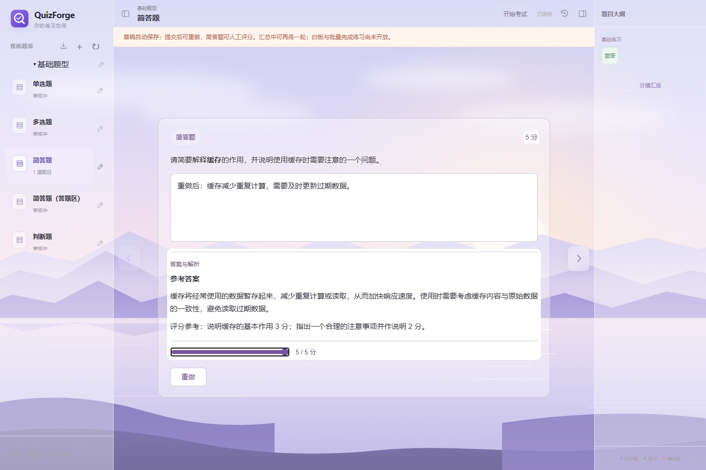
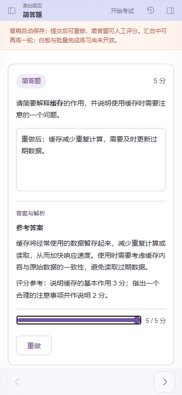
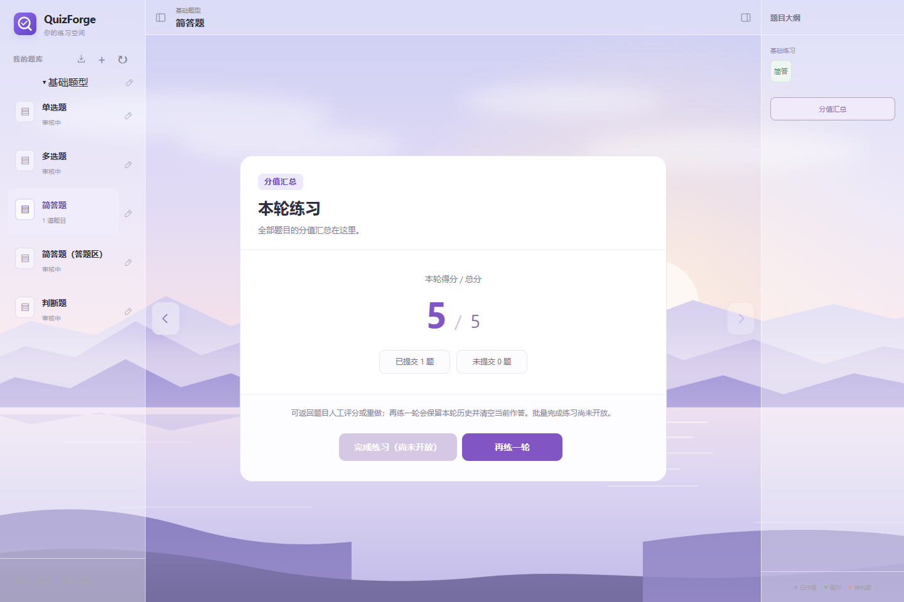
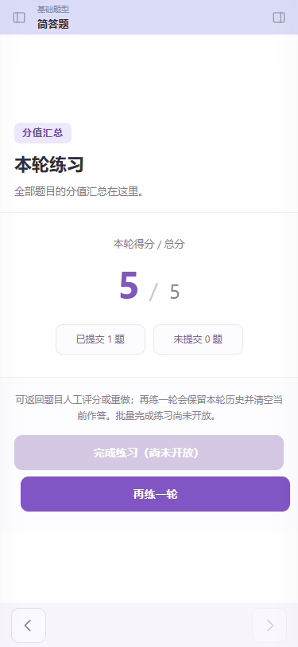

# L1.1 / L1.2 练习闭环报告

## 实现与文件

| 文件（backend 路径均在 `src/main/java/cloud/treenewbee/quizforge/` 下） | 改动及理由 |
| --- | --- |
| practice/application/PracticeLifecycleService.java | retry / review / restart；同事务保存完整响应回执，冲突后新事务重查；context → state → round 锁顺序 |
| practice/application/ReviewGrader.java | 在事务外调用真实 review，再用 scoreBatch 获取评分及大纲状态；评分语义由拓展决定 |
| practice/application/PracticeSummaryService.java | SQL 聚合、一致性读事务；汇总版本覆盖 progress_version 与每题 revision，避免遗漏草稿更新 |
| practice/infrastructure/PracticeLifecycleMapper.java | 归属限定查询、状态锁、原地重置、人工评分、冻结单题及轮次汇总更新 |
| practice/web/PracticeLifecycleController.java | GET summary / POST restart，校验请求、会话身份、no-store |
| practice/web/PracticeActionController.java | 接入 retry / review，沿用前端 data.review / requestId / revision / contentVersion |
| practice/application/PracticeReadService.java、practice/infrastructure/PracticeReadMapper.java | 增加题库定位与当前轮次状态查询，按提交状态、轮次及 manifest.manual-review 开放能力 |
| practice/application/SubmitService.java、SubmitActionService.java | 新提交回执保存完整 HTTP 响应；适配器优先使用冻结响应，保留旧 revision-only 回执读取分支 |
| frontend/practice/app.js | 再练一轮确认提示；更新可用功能说明 |
| frontend/practice/practice/practice-summary.js、.css | 汇总待评分提示、独立再练一轮入口；尚未实现的 finish 明确禁用，保留旧组件能力兼容 |
| docs/design/02-api.md、07-frontend-api-map.md、frontend/UPSTREAM.md | 记录接口、并发决定、旧限制更新及前端分叉改动 |
| backend/src/test/.../PracticeLifecycleIntegrationTest.java | MySQL + 真实 rule-runner 集成、HTTP、事务回滚及并发测试 |
| frontend/test/practice-lifecycle.test.mjs | 汇总组件、能力开关、单飞与失败重试测试 |
| frontend/test/browser/practice-lifecycle.spec.mjs | 独立 Compose 下真实 iframe 的桌面/手机闭环与截图 |
| 本目录 | 验证报告及四张截图；截图不放在 frontend 中 |

未引入依赖或迁移。DraftService、IdempotentDraftService、QuestionStateMapper 未修改。

## 接口与并发语义

- retry：仅允许进行中轮次的 submitted 题。清空作答及评分列，revision / grading_generation / submission_generation 各增加 1，保留原轮次单题快照；再提交才更新该快照。已完成轮次在加载未提交投影之前就拒绝。
- review：只允许支持 manual-review 的 submitted 题，作答从数据库读取。review / scoreBatch 均在写事务外运行；写事务检查原 revision，再更新评分、投影、大纲状态及轮次单题快照。score 和 maxScore 均 HALF_UP 四位小数，grading_generation 增加 1。completed 轮次可改分，并同步冻结汇总。
- summary：单题 pending 的 score 保持 null、总分按 0 计，提供 pendingCount；题序来自 content_question.position；不调用规则。未提交题的满分来自内容，已提交题使用持久化满分。
- restart：检查 roundId / summaryVersion，锁 context 及全部作答行后读取最新版本；原地清空状态并增加 revision / generation，删除白板，进行中轮次归档为 completed、冻结重置前汇总，清空 current_round_id、progress_version+1，最后写回执。不删除状态行、旧轮次或旧回执。
- 所有写操作只从会话获取用户身份，定位时复核题库归属和审核可用性；相同 requestId 相同请求返回原完整响应，换内容返回 400 REQUEST_ID_REUSED。竞争/409 后在新事务中重查回执。命中回执不调用规则；同 ID 首次并发请求仍可能各自执行事务外规则，但只提交一次数据库变更，与既有提交的并发方式一致。
- SubmitService 原有先保存草稿 → 事务外判分 → 事务内乐观锁写入的顺序、context 锁与回执重查保持不变；仅将事务末尾的回执内容由 revision 扩为完整响应。
- 2026-11-01 产品确认：同 revision 并发人工评分，一个成功、另一个 409；刷新后可再次评分。每次成功评分递增 grading_generation，AI 任务本身属于后续 L5。
- 本任务明确允许 restart 归档进行中的轮次，取代旧错误码表 PRACTICE_NOT_FINISHED 的限制；API 文档已同步。finish 属于 L1.3，当前 canFinish=false，canRestart=true。

## 新增后端测试对应表

测试类 `PracticeLifecycleIntegrationTest`，共 39 次执行（参数化按实际次数计）。并发门控均使用 CountDownLatch，不通过 sleep 判断并发状态。

| 覆盖 | 测试方法 | 次数 |
| --- | --- | --- |
| 五种题型重做、列清空、版本递增、历史保留、重提、重放及 requestId 复用 | retryClearsLiveAnswerButPreservesFrozenSubmissionAndCanResubmit | 5 |
| 两种简答题真实人工评分、最后一次评分、generation、单题快照与重放 | reviewUsesRealExtensionAndLastSuccessfulScoreUpdatesStateAndSnapshot | 2 |
| completed 轮次禁止重做、允许改分并更新冻结汇总 | completedRoundRejectsRetryButAllowsReviewAndUpdatesFrozenSummary | 1 |
| 规则不可用时 completed 重做仍先返回状态错误 | completedRetryRejectsBeforeLoadingProjectionEvenWhenRunnerIsUnavailable | 1 |
| 未提交/旧 revision 不允许 retry / review | unsubmittedAndStaleRevisionRejectWithoutWrites | 2 |
| 客观题不宣称人工评分能力；规则拒绝不改状态 | objectiveTypeDoesNotAdvertiseManualReviewAndRunnerRejectionKeepsSubmittedState | 1 |
| 五类型汇总、pending/null、总分、题序、无规则调用与无答案泄露 | summaryAggregatesAllTypesPendingIsNullAndReadsNeverExecuteRules | 1 |
| restart 原地清理、白板删除、冻结汇总/历史、精确重放、再次提交创建新轮次 | restartFreezesInProgressRoundResetsInPlaceDeletesWhiteboardAndReplaysExactly | 1 |
| 无轮次仅草稿的重置；草稿 revision 改变汇总版本 | restartWithoutRoundResetsDraftAndDraftRevisionInvalidatesSummaryVersion | 1 |
| retry / review / summary / restart 的 IDOR | allLifecycleEndpointsRejectOtherUsersCollection | 4 |
| retry / review / restart 写回执失败则全部回滚 | receiptFailureRollsBackEveryLifecycleMutation | 3 |
| 同 requestId 真正并发的 retry / review / restart 仅改一次、响应一致 | duplicateConcurrentRequestHasOneMutationAndIdenticalResponses | 3 |
| 同 revision 并发人工评分一成功一 409；判分期间无状态锁 | concurrentReviewsAtSameRevisionHaveOneWinnerAndNoLockDuringGrading | 1 |
| 提交判分期间 restart；旧结果不能入库、不创建轮次 | restartWhileSubmissionIsGradingRejectsOldResultWithoutCreatingRound | 1 |
| 人工评分期间 restart；旧评分不能写入、历史不被改写 | restartWhileReviewIsGradingRejectsOldReviewAndPreservesOldHistory | 1 |
| review 规则服务不可用返回 503、不改变原提交 | reviewUnavailableRunnerReturns503WithoutChangingSubmission | 1 |
| score / maxScore 的 HALF_UP 存储、响应及快照一致 | reviewRoundsBothScoresHalfUpInStateResponseAndFrozenSnapshot | 1 |
| restart 等待期间已提交的草稿不能被旧一致性快照漏掉 | restartChecksDraftCommittedWhileItWasWaitingBeforeTakingStateLocks | 1 |
| 原 submit 在 retry / review / restart 后仍精确重放，submit 只调用一次 | originalSubmissionReplayRemainsIdenticalAfterRetryReviewAndRestart | 1 |
| 不同 requestId、相同旧版本的 retry / restart 一成功一 409 | concurrentDifferentRequestsHaveOneWinnerAndOne409 | 2 |
| 四接口被撤销审核时先拒绝，不执行规则/写入 | revokedApprovalRejectsLifecycleEndpointsBeforeAnyRuleOrWrite | 4 |
| 请求字段/长度/分值/restart 校验、Origin、匿名访问 | invalidLifecycleBodiesAndOriginAreRejected | 1 |

新增前端 4 项：未完成汇总独立 restart、单飞与失败重试、旧版已完成及历史只读兼容、服务端能力控制。新增浏览器用例在 desktop / mobile 各运行一次，其余原浏览器测试继续保留。

## 验证结果

最终完整 `mvn -B -ntp verify`：**3052 项，0 失败、0 错误、3 个已有跳过，BUILD SUCCESS**（8 分 13 秒）。CI 四个 job 的最终链接和结果在 PR 描述补充。

- 首轮完整 Maven：3051 项，1 失败、0 错误、3 个已有跳过。唯一失败为未修改的 `ImportIntegrationTest.everyFailureHasCorrectHttpCodeAndNoBusinessResidue[12]`（rule rejection）：期望 422 RULE_REJECTED，实际 503 RULE_UNAVAILABLE。该轮与本地 Compose 构建/浏览器验证同时运行；尚无证据确定其根因，未据此放宽超时或修改导入/runner。最终串行回归结果另记。
- 原有草稿/提交/快照加新增闭环的定向回归：93 项，0 失败、0 错误（新增第 39 项之前）。
- 前端 `npm run build`、`npm test`：36 项，0 失败。
- 独立 Compose `qf-practice-review-restart`，`http://localhost:8102`：完整 Playwright 10 项（desktop 5 + mobile 5）全部通过。真实 Cookie、上传导入、测试白名单、iframe 与真实 runner；无模拟业务写入。
- `git diff --check` 通过。

## 浏览器复核步骤与截图

1. 注册测试用户、导入 samples/basic-types.qbank，在隔离测试库批准对应拓展；进入“简答题”。审核白名单仅为测试夹具。
2. 在真实拓展富文本框作答 → 提交 → 点击重做，确认答案和结果清空 → 再作答并提交。
3. 将人工评分滑条调至满分，确认 5 / 5 分、大纲变为绿色；刷新后仍显示该结果。
4. 下一题进入汇总，确认 5 / 5 分、完成练习按钮明确禁用、再练一轮可用。
5. 点击再练一轮并确认，回到空白可作答状态；刷新后仍为空白。
6. desktop 和 375px mobile 均执行上述流程，断言无页面异常和横向滚动。

| 桌面 | 手机 |
| --- | --- |
|  |  |
|  |  |

## 发现并处理的问题、边界

1. **旧 submit 回执仅保存 revision，在后续改分后会返回最新结果。** 新增复现测试 `originalSubmissionReplayRemainsIdenticalAfterRetryReviewAndRestart` 在修复前失败，修复后通过。新回执在原提交事务内冻结完整响应；既有回执没有的历史字段无法恢复，兼容分支仍会按旧方式构造响应，不做推测回填。
2. **restart 的汇总版本需覆盖草稿更新。** 草稿不增加 progress_version；汇总签名同时覆盖每题 revision，并在 context / state 锁取得之后才首次进行一致性读取。专门门控测试验证等待期间保存的草稿会使旧汇总冲突。
3. 需求中人工评分最后一次与乐观锁的边界已由产品确认；未自行改成覆盖式写入。进行中 restart 与旧 API 限制的冲突按本次明确任务更新文档。
4. 完成练习批量判分、历史查看界面、AI、白板保存属于后续 L1.3 / L1.4 / L5 / L1.5；本任务保留历史数据但不新增这些接口。存量 revision-only submit 回执的精确历史响应无法还原，是本次保留的兼容限制。

本地测试仅使用自有隔离项目；结束时执行该项目 compose down（不删除卷），不停止用户其他项目。
